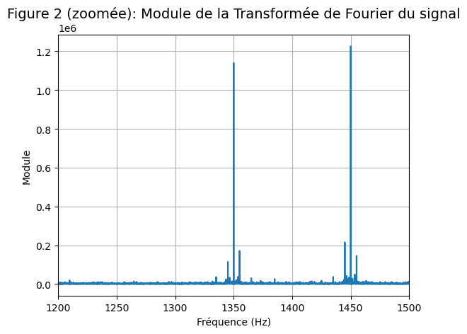
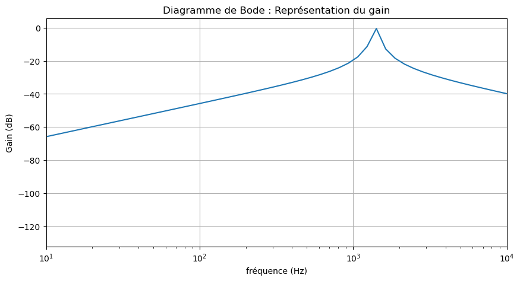
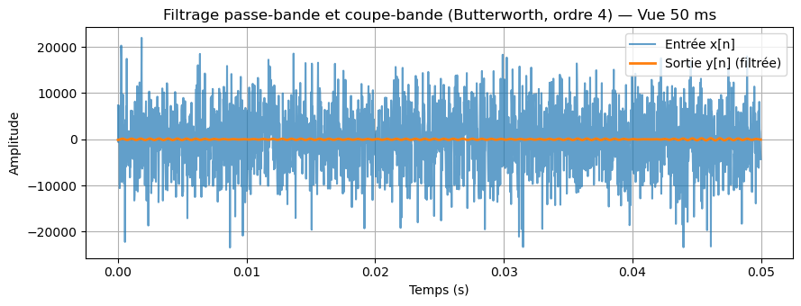
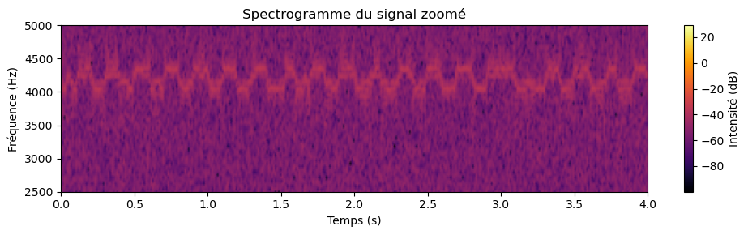

# Traitement du signal : analyse d'un signal radio bruité

Projet de traitement du signal réalisé en groupe de 3 au **CESI** (cycle préparatoire ingénieur, 2025). Un son étrange, capté par le radiotélescope de Nançay, est noyé dans le bruit. Notre mission : retrouver ce qu'il contient et comprendre comment un tel message peut être émis et reçu.

Tout le travail est regroupé dans un notebook Jupyter, organisé en 4 étapes (les « livrables »).

## Démarche

**1. Analyse spectrale**
- Spectrogramme et transformée de Fourier du signal brut : il est presque entièrement du bruit, mais deux pics ressortent à **1350 Hz** et **1450 Hz**.

**2. Filtre analogique (RLC d'ordre 2)**
- Choix d'un filtre passe-bande centré sur 1400 Hz (facteur de qualité Q = 14), pour garder les deux fréquences utiles.
- Diagramme de Bode (gain et phase) tracé en Python, puis comparé à une simulation du circuit et à des mesures sur un montage réel.

**3. Filtrage numérique, démodulation et décodage**
- Filtre de Butterworth d'ordre 4 (passe-bande puis coupe-bande), appliqué sans déphasage.
- Le spectrogramme du signal filtré montre une alternance entre deux fréquences : c'est une **modulation FSK** (1350 Hz et 1450 Hz, 10 bits par seconde, 128 bits).
- Démodulation par corrélation avec deux porteuses, puis décodage **Manchester**.
- Essai d'un chiffrement XOR sur les 256 clés possibles (force brute), sans résultat lisible.
- Conclusion : les 8 octets obtenus valent 0, 1, 4, 9, 16, 25, 36 et 49, c'est-à-dire les carrés parfaits de 0 à 7. Le signal n'est donc pas un phénomène astronomique, mais une suite de nombres au carré.

**4. Prototype d'émission et de réception**
- Chaîne d'émission : message ASCII, chiffrement XOR (clé 0x4F), binaire, codage Manchester, modulation FSK, puis audio joué par les haut-parleurs.
- Chaîne de réception : enregistrement au microphone, filtrage numérique, démodulation FSK, décodage Manchester, ASCII, puis déchiffrement XOR.

## Aperçu des résultats

**Deux pics de fréquence dans le signal**



**Diagramme de Bode du filtre passe-bande**



**Signal avant et après filtrage numérique**



**Spectrogramme du signal filtré : alternance entre deux fréquences (FSK)**



## Contenu du dépôt

```
.
├── README.md
├── notebook/
│   └── traitement_signal_radio_bruite.ipynb
└── figures/
```

## Lancer le notebook

```bash
pip install numpy scipy matplotlib jupyter
jupyter notebook notebook/traitement_signal_radio_bruite.ipynb
```

- Le fichier audio du signal (`signal_recu_transpose.wav`) est fourni par l'enseignement et n'est pas inclus dans ce dépôt. Il faut le placer dans le même dossier que le notebook pour exécuter les premières parties.
- La partie réception du livrable 4 utilise la bibliothèque `sounddevice` (`pip install sounddevice`) et un microphone. Elle est prévue pour fonctionner sur un deuxième ordinateur, qui capte l'audio émis par le premier.

## Compétences mobilisées

Transformée de Fourier et spectrogrammes · filtrage analogique et numérique · diagramme de Bode · modulation et démodulation FSK · codage Manchester · chiffrement XOR · Python (NumPy, SciPy, Matplotlib) · Jupyter

## Auteurs

Projet réalisé en groupe de 3 étudiants au CESI.

**Ilyass AIT ALI** · étudiant ingénieur informatique
[Portfolio](https://ilyassa1.github.io) · [LinkedIn](https://www.linkedin.com/in/ilyass-ait-ali/)

*Projet pédagogique réalisé dans le cadre de la formation CESI.*

<!--
OPTIONNEL : pour ajouter ta contribution, décommente et complète cette section.

## Ma contribution
- (par exemple : filtrage numérique / démodulation FSK / prototype d'émission)
-->
